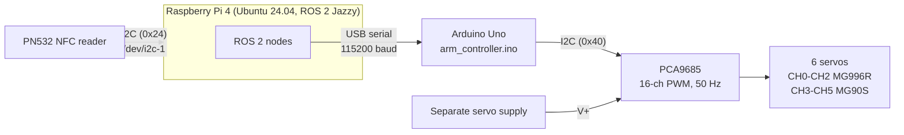
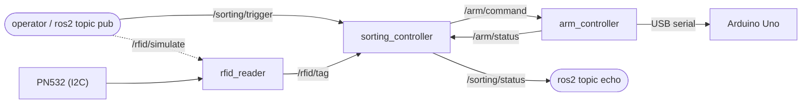

# Robotic RFID Sorting Cell

A fixed robotic sorting cell: an object placed by hand at a pickup spot is
picked up by a 5-DOF arm, carried over a PN532 RFID reader, identified from
its tag UID, and dropped into the matching bin. A Raspberry Pi 4 runs the
ROS 2 nodes, and an Arduino Uno drives the servos through a PCA9685 board.

**Scope.** This project is the fixed cell only. A conveyor belt, automatic
object detection, and grip or placement verification sensors are **not**
part of it. The repository and package are still called
`autonomous-conveyor-sorting-cell` / "Autonomous Conveyor Sorting Cell"
because the original plan included a conveyor, which was dropped from the
scope.

---

## Contents

1. [Contributors](#contributors)
2. [What it does](#what-it-does)
3. [Architecture](#architecture)
4. [Hardware](#hardware)
5. [Wiring and power](#wiring-and-power)
6. [Setup](#setup)
7. [Running it](#running-it)
8. [Configuration](#configuration)
9. [Serial protocol](#serial-protocol)
10. [Tests](#tests)
11. [Verification status](#verification-status)
12. [Troubleshooting](#troubleshooting)
13. [Safety notes](#safety-notes)
14. [Future work](#future-work)
15. [License](#license)

---

## Contributors

- Diya Jabin
- Grace Maria James
- Basil Joseph

---

## What it does

One cycle per trigger message, run by `sorting_controller.py`
(`SortingControllerCore.run_cycle`):

1. **Home:** move to `HOME_POSITION`.
2. **Open gripper.**
3. **Pick down:** move to `PICK_DOWN_POSITION` at the pickup spot.
4. **Grip:** close the gripper.
5. **Lift:** move to `LIFT_POSITION` to raise the object clear of the pickup spot.
6. **Scan position:** move to `RFID_SCAN_POSITION`, holding the object over the fixed PN532 reader, then wait a further 0.5 s for it to stop swinging.
7. **Wait for tag:** wait up to 15 s for a UID on `/rfid/tag`.
8. **Identify:** look up the UID in `config/object_map.yaml` to get the object name and its bin.
9. **Floating pose:** move to `FLOATING_POSITION` (same base angle as the scan pose, raised).
10. **Bin:** move to `BIN_A_POSITION` or `BIN_B_POSITION`.
11. **Release:** open the gripper.
12. **Home:** report the sort and move back to `HOME_POSITION`, then go `IDLE`.

Each position move sends the five joints one at a time in the order base,
shoulder, elbow, wrist roll, wrist pitch. The arm controller waits
`joint_gap_seconds` (0.6 s) between joints and `move_settle_seconds` (2 s)
after the last one. After each gripper command it waits
`gripper_settle_seconds` (1 s). These waits are there because the Arduino
replies `OK` as soon as it accepts a target, before the servo has actually
moved.

### Failure handling

| Failure | Status published | What the arm does |
|---|---|---|
| A required pose is missing from `arm_positions.yaml` (checked at cycle start, and for the bin pose after identification) | `ERROR:INVALID_CONFIGURATION:MISSING_POSITION:<names>` | Best-effort move to `HOME_POSITION`, then `IDLE` |
| No tag within `rfid_timeout` | `ERROR:RFID_TIMEOUT` | Best-effort move to `HOME_POSITION` **still holding the object**, then `IDLE` |
| UID not in `object_map.yaml` | `ERROR:UNKNOWN_UID:<uid>` | Best-effort move to `HOME_POSITION` **still holding the object**, then `IDLE` |
| An arm command is rejected, times out, or the serial link fails | `ERROR:ARM_FAILURE:<step>:<command>:<arm status>` (position moves) or `ERROR:ARM_FAILURE:<step>:<arm status>` (gripper) | Best-effort move to `HOME_POSITION`, then `IDLE` |
| The final move home after a successful sort fails | `ERROR:ARM_FAILURE:HOME:...` | Stops there. No retry, and no `IDLE` is published |

"Best-effort" means the controller tries the move home once. If that also
fails, it logs the error and publishes `IDLE` anyway. On failure the gripper
is never opened on purpose, so the object is not dropped at an arbitrary
point. A trigger that arrives while a cycle is running is ignored with a
warning. It is not queued.

---

## Architecture

### Hardware path



### ROS 2 nodes and topics



### Cycle status sequence (`/sorting/status`)

A successful cycle publishes these strings in order:

| # | Status string | Meaning |
|---|---|---|
| 0 | `IDLE` | Published once when the node starts, and at the end of every cycle |
| 1 | `CYCLE_START` | Trigger accepted |
| 2 | `EXECUTING:MOVE_TO_HOME_POSITION` | Moving to `HOME_POSITION` |
| 3 | `EXECUTING:OPEN_GRIPPER` | Opening the gripper |
| 4 | `EXECUTING:MOVE_TO_PICK_DOWN_POSITION` | Descending to the object |
| 5 | `EXECUTING:GRIP` | Closing the gripper |
| 6 | `EXECUTING:LIFT_AFTER_GRIP` | Moving to `LIFT_POSITION` |
| 7 | `EXECUTING:MOVE_TO_RFID_SCAN` | Moving to `RFID_SCAN_POSITION` |
| 8 | `WAITING_FOR_RFID` | Waiting for `/rfid/tag` |
| 9 | `RFID_DETECTED:<uid>` | Tag received |
| 10 | `IDENTIFIED:<object_name>` | UID found in the object map |
| 11 | `BIN_SELECTED:<bin>` | e.g. `BIN_A` |
| 12 | `EXECUTING:MOVE_TO_FLOATING` | Moving to `FLOATING_POSITION` |
| 13 | `EXECUTING:MOVE_TO_BIN:<bin>` | Moving to the bin pose |
| 14 | `EXECUTING:RELEASE` | Opening the gripper over the bin |
| 15 | `REPORT:SORTED:<uid>:<object_name>:<bin>` | Sort done. The arm then moves home without publishing a separate status |
| 16 | `IDLE` | Back at `HOME_POSITION` |

Error strings are listed under [Failure handling](#failure-handling).

### Nodes

All three nodes are in the `sorting_cell` package (`ros2_ws/src/sorting_cell/sorting_cell/`).

| Node (executable) | File | Role |
|---|---|---|
| `arm_controller` | `arm_controller.py`, `serial_interface.py` | Checks `/arm/command` strings against the joint limits, sends them to the Arduino over serial, and publishes the result on `/arm/status` |
| `rfid_reader` | `rfid_reader.py` | Polls the PN532 over I2C and publishes each newly detected UID on `/rfid/tag`. It also forwards `/rfid/simulate` |
| `sorting_controller` | `sorting_controller.py`, `object_map.py`, `positions.py` | Runs the pick, scan and sort cycle described above |

### Topics

All topics use `std_msgs/msg/String`.

| Topic | Publisher | Subscriber | Content |
|---|---|---|---|
| `/sorting/trigger` | operator | `sorting_controller` | Any string. Starts one cycle |
| `/sorting/status` | `sorting_controller` | operator | Cycle progress and errors (table above) |
| `/arm/command` | `sorting_controller` (or operator) | `arm_controller` | `BASE <deg>`, `SHOULDER <deg>`, `ELBOW <deg>`, `WRIST <deg>`, `WRIST_PITCH <deg>`, `GRIPPER OPEN`, `GRIPPER CLOSE`, `HOME` |
| `/arm/status` | `arm_controller` | `sorting_controller` | `IDLE`, `EXECUTING:<action>`, `OK:<action>`, `ERROR:...` |
| `/rfid/tag` | `rfid_reader` | `sorting_controller` | Uppercase hex UID, no separators (e.g. `1DF058BA141080`) |
| `/rfid/simulate` | operator | `rfid_reader` | A UID to inject as if it had been read (works in both modes) |

### Parameters

**`arm_controller`**

| Parameter | Default | Notes |
|---|---|---|
| `mock_mode` | `false` | `true` simulates the Arduino's replies and opens no port |
| `serial_port` | `/dev/ttyACM0` | This cell uses `/dev/ttyUSB0` |
| `baud_rate` | `115200` | Must match the firmware |
| `serial_timeout` | `1.0` s | Time to wait for each reply line |
| `joint_limits.base.min` / `.max` | `0.0` / `180.0` | |
| `joint_limits.shoulder.min` / `.max` | `15.0` / `165.0` | |
| `joint_limits.elbow.min` / `.max` | `15.0` / `175.0` | |
| `joint_limits.wrist.min` / `.max` | `0.0` / `180.0` | Wrist roll |
| `joint_limits.wrist_pitch.min` / `.max` | `0.0` / `180.0` | |
| `home_positions.*` | `90.0` | Declared but **not used** anywhere |

The 2 s boot delay after opening the port is a `SerialInterface` constructor
argument (`boot_delay=2.0`), not a ROS parameter.

**`rfid_reader`**

| Parameter | Default | Notes |
|---|---|---|
| `mock_mode` | `true` (node default) | The launch file sets it to `false` unless you pass `mock_mode:=true` |
| `poll_interval` | `0.2` s | How often the PN532 is polled |
| `i2c_address` | `0x24` (36) | PN532 I2C address |

**`sorting_controller`**

| Parameter | Default | Notes |
|---|---|---|
| `object_map_path` | `""` | Empty means the installed `share/sorting_cell/config/object_map.yaml` |
| `positions_path` | `""` | Empty means the installed `share/sorting_cell/config/arm_positions.yaml` |
| `arm_command_timeout` | `5.0` s | Time to wait for an `OK:`/`ERROR:` on `/arm/status` per command |
| `rfid_timeout` | `15.0` s | Time to wait for a tag once `WAITING_FOR_RFID` is published |
| `move_settle_seconds` | `2.0` s | Wait after each position move |
| `gripper_settle_seconds` | `1.0` s | Wait after each gripper command |
| `rfid_settle_seconds` | `0.5` s | Extra wait at the scan pose before the tag wait starts |
| `joint_gap_seconds` | `0.6` s | Wait between joints within a move (not after the last joint) |

### Launch arguments (`launch/sorting_cell.launch.xml`)

| Argument | Default | Passed to |
|---|---|---|
| `mock_mode` | `false` | `arm_controller`, `rfid_reader` |
| `serial_port` | `/dev/ttyACM0` | `arm_controller` |
| `baud_rate` | `115200` | `arm_controller` |
| `serial_timeout` | `1.0` | `arm_controller` |
| `object_map_path` | `""` | `sorting_controller` |
| `positions_path` | `""` | `sorting_controller` |
| `arm_command_timeout` | `5.0` | `sorting_controller` |
| `rfid_timeout` | `15.0` | `sorting_controller` |
| `move_settle_seconds` | `2.0` | `sorting_controller` |
| `gripper_settle_seconds` | `1.0` | `sorting_controller` |
| `rfid_settle_seconds` | `0.5` | `sorting_controller` |
| `joint_gap_seconds` | `0.6` | `sorting_controller` |

The joint limits, `poll_interval` and `i2c_address` are not launch
arguments. `launch/arm.launch.xml` starts `arm_controller` alone (with the
first four arguments) for testing the arm without the rest of the cell.

---

## Hardware

| Part | Details |
|---|---|
| Main computer | Raspberry Pi 4 Model B (4 GB) |
| Servo controller | Arduino Uno |
| PWM driver | PCA9685 16-channel, 12-bit (I2C address 0x40) |
| Arm | 5-DOF 3D-printed arm (Bench Robotics) plus gripper |
| Servos | 3× MG996R (base, shoulder, elbow), 3× MG90S (wrist roll, wrist pitch, gripper) |
| RFID reader | PN532 NFC module (I2C mode, address 0x24) |
| Tags | NTAG213 |
| Servo power | Separate supply into the PCA9685 V+ terminal |

---

## Wiring and power

The full wiring tables are in [hardware/WIRING.md](hardware/WIRING.md). Summary:

**Raspberry Pi to PN532 (I2C)**

| PN532 | Raspberry Pi |
|---|---|
| 5V | Physical pin 1 (**3.3V**) |
| GND | Physical pin 6 |
| MO/SDA/TX | Physical pin 3 (SDA) |
| NSS/SCL/RX | Physical pin 5 (SCL) |
| MI, SCK, RST, IRQ | not connected |

Mode switches: **SET0 = H, SET1 = L** (I2C). Address `0x24`.
**Do not connect the PN532 5V pin to the Pi's 5V pins.**

**Arduino to PCA9685:** the Arduino's I2C pins go to the PCA9685 SDA and SCL,
plus ground (A4/A5 on the Uno, as listed in the earlier docs; confirm against
your build). **Pi to Arduino:** USB, serial at 115200 baud, `/dev/ttyUSB0` on
this cell.

**Servo channels and calibration** (from the firmware, PCA9685 counts at 50 Hz)

| Channel | Joint | Servo | Min | Mid | Max |
|---|---|---|---|---|---|
| CH0 | Base | MG996R | 100 | 310 | 520 |
| CH1 | Shoulder | MG996R | 100 | 310 | 520 |
| CH2 | Elbow | MG996R | 100 | 310 | 520 |
| CH3 | Wrist roll | MG90S | 87 | 313 | 538 |
| CH4 | Wrist pitch | MG90S | 87 | 313 | 538 |
| CH5 | Gripper | MG90S | 87 | 311 | 535 |

Gripper: open = 150°, close = 20° (set in the firmware).

**Power rules**

- Run the servos from a separate supply into the PCA9685 **V+** screw terminal, with its ground shared with the Arduino.
- **Never** power the servos from the Arduino's 5V pin.
- Use a supply with several amps of headroom. A USB power bank caused shaking and stalling during testing.

---

## Setup

All steps run on the Raspberry Pi unless stated otherwise.

1. **Install Ubuntu Server 24.04** (64-bit, Raspberry Pi image) on the SD
   card with Raspberry Pi Imager, and enable SSH in the imager settings. Boot
   the Pi and SSH in.

2. **Install ROS 2 Jazzy** by following the official guide for Ubuntu deb
   packages: <https://docs.ros.org/en/jazzy/Installation/Ubuntu-Install-Debs.html>
   (`ros-jazzy-ros-base` is enough). Then:
   ```bash
   echo "source /opt/ros/jazzy/setup.bash" >> ~/.bashrc
   source ~/.bashrc
   ```

3. **Enable I2C.** Make sure this line is in `/boot/firmware/config.txt`,
   then reboot:
   ```
   dtparam=i2c_arm=on
   ```

4. **Install tools and dependencies:**
   ```bash
   sudo apt install i2c-tools python3-pip python3-colcon-common-extensions \
                    python3-serial python3-yaml
   ```
   (`python3-serial` and `python3-yaml` are the `exec_depend`s in
   `package.xml`.)

5. **Clone the repository:**
   ```bash
   git clone https://github.com/DiyaJabin/autonomous-conveyor-sorting-cell.git
   cd autonomous-conveyor-sorting-cell
   ```

6. **Install the pip dependencies** (PN532 driver, Blinka, RPi.GPIO):
   ```bash
   pip3 install -r ros2_ws/src/sorting_cell/requirements.txt --break-system-packages
   ```

7. **Build:**
   ```bash
   cd ros2_ws
   colcon build --packages-select sorting_cell
   source install/setup.bash
   ```
   Run `source install/setup.bash` again in every new terminal.

8. **Flash the Arduino**, from whichever machine the Arduino is plugged into
   (the Pi or a laptop). Stop any running ROS launch first, since it holds
   the port:
   ```bash
   arduino-cli core update-index
   arduino-cli core install arduino:avr
   arduino-cli lib install "Adafruit PWM Servo Driver Library"
   arduino-cli compile --fqbn arduino:avr:uno arduino/arm_controller
   arduino-cli upload -p /dev/ttyUSB0 --fqbn arduino:avr:uno arduino/arm_controller
   ```
   (Run from the repository root. Use `arduino-cli board list` to find the port.)

9. **Check the hardware:**
   ```bash
   ls /dev/ttyUSB*     # the Arduino, e.g. /dev/ttyUSB0
   i2cdetect -y 1      # the PN532 should show up as 24
   ```
   If the serial port gives "permission denied", add yourself to the
   `dialout` group (`sudo usermod -aG dialout $USER`) and log in again. If
   `i2cdetect` is denied, run it with `sudo`.

---

## Running it

Only one program at a time can use the Arduino's serial port. Close any
serial monitor, and make sure no other machine or terminal has the launch
running, before you start.

**Terminal 1: launch the cell**
```bash
ros2 launch sorting_cell sorting_cell.launch.xml mock_mode:=false serial_port:=/dev/ttyUSB0
```

**Terminal 2: watch the cycle**
```bash
ros2 topic echo /sorting/status
```

**Terminal 3 (optional): watch tag reads**
```bash
ros2 topic echo /rfid/tag
```

**Place an object at the pickup spot, then start a cycle:**
```bash
ros2 topic pub --once /sorting/trigger std_msgs/msg/String "data: ''"
```

A good cycle prints the following on `/sorting/status`, with each line
appearing as `data: ...` followed by `---`:

```
CYCLE_START
EXECUTING:MOVE_TO_HOME_POSITION
EXECUTING:OPEN_GRIPPER
EXECUTING:MOVE_TO_PICK_DOWN_POSITION
EXECUTING:GRIP
EXECUTING:LIFT_AFTER_GRIP
EXECUTING:MOVE_TO_RFID_SCAN
WAITING_FOR_RFID
RFID_DETECTED:1DF058BA141080
IDENTIFIED:OBJECT_A2
BIN_SELECTED:BIN_A
EXECUTING:MOVE_TO_FLOATING
EXECUTING:MOVE_TO_BIN:BIN_A
EXECUTING:RELEASE
REPORT:SORTED:1DF058BA141080:OBJECT_A2:BIN_A
IDLE
```

A full cycle takes about 40 s.

### Mock mode (no hardware)

```bash
ros2 launch sorting_cell sorting_cell.launch.xml mock_mode:=true
ros2 topic pub --once /sorting/trigger std_msgs/msg/String "data: ''"
# once /sorting/status shows WAITING_FOR_RFID (within 15 s):
ros2 topic pub --once /rfid/simulate std_msgs/msg/String "data: '1DF058BA141080'"
```

Mock mode opens no serial port or I2C bus, and `arm_controller` fakes the
Arduino's `OK` replies. The settle and gap waits still run, so a mock cycle
takes about as long as a real one. A tag published **before**
`WAITING_FOR_RFID` is discarded (see [Known limitations](#known-limitations)).
`rfid_reader` ignores a UID that matches the previous one, so to send the
same UID again, first publish an empty one (`"data: ''"`) to `/rfid/simulate`.

---

## Configuration

Both config files live in `ros2_ws/src/sorting_cell/config/` and are
**installed at build time**. After editing either one, run
`colcon build --packages-select sorting_cell` again, or pass the source file
with `object_map_path:=...` / `positions_path:=...`.

### Tags: `config/object_map.yaml`

Current tags:

| UID | Object name | Bin |
|---|---|---|
| `1DF058BA141080` | `OBJECT_A2` | `BIN_A` |
| `1DEF58BA141080` | `OBJECT_A3` | `BIN_A` |
| `1DEC58BA141080` | `OBJECT_B2` | `BIN_B` |
| `1DEE58BA141080` | `OBJECT_B3` | `BIN_B` |
| `1DED58BA141080` | `OBJECT_B4` | `BIN_B` |

To add a tag:

1. Read its UID: hold the tag over the reader with the cell running and
   watch `ros2 topic echo /rfid/tag`. UIDs are uppercase hex with no
   separators.
2. Add an entry under `objects:`:
   ```yaml
     1DXXXXXXXXXXXX:
       object_name: OBJECT_A4
       bin: BIN_A
   ```
   `bin` must match a pose named `<bin>_POSITION` in `arm_positions.yaml`.
   Several UIDs can share a bin.
3. Rebuild.

A UID that is not in the file ends the cycle with `ERROR:UNKNOWN_UID:<uid>`.

### Poses: `config/arm_positions.yaml`

Angles are in degrees. `wrist` is wrist roll (CH3) and `wrist_pitch` is CH4.
If a pose leaves out `wrist_pitch`, it defaults to 0.

| Pose | Base | Shoulder | Elbow | Wrist | Wrist pitch | Source |
|---|---|---|---|---|---|---|
| `HOME_POSITION` | 0 | 105 | 95 | 100 | 90 | Measured |
| `PICK_DOWN_POSITION` | 0 | 85 | 175 | 35 | 95 | Re-measured 2026-10-20 |
| `LIFT_POSITION` | 0 | 85 | 125 | 35 | 95 | **Derived** from `PICK_DOWN_POSITION` (elbow raised), not measured; works on the arm in full cycles |
| `RFID_SCAN_POSITION` | 55 | 90 | 175 | 0 | 100 | Re-measured 2026-10-20 |
| `FLOATING_POSITION` | 55 | 110 | 155 | 15 | 100 | Base equals the scan pose's; other joints equal the bin poses' |
| `BIN_A_POSITION` | 85 | 110 | 155 | 15 | 100 | Measured 2026-10-15 |
| `BIN_B_POSITION` | 110 | 110 | 155 | 15 | 100 | Base measured; shoulder and wrist aligned to `BIN_A_POSITION` and checked on the arm |

`HOME_POSITION`, `PICK_DOWN_POSITION`, `LIFT_POSITION`, `RFID_SCAN_POSITION`
and `FLOATING_POSITION` are required. The config fails to load without them.
To add a bin, add a `BIN_X_POSITION` pose and point tags at `bin: BIN_X`.
Keep `FLOATING_POSITION` in step with the scan base and the bin poses (see
the comment in the file). Rebuild after any change.

### Joint limits

`arm_controller` rejects any angle outside these limits
(`ERROR:INVALID_COMMAND` on `/arm/status`, with `ANGLE_OUT_OF_LIMITS` in its
log). They are set in two places in `sorting_cell/arm_controller.py`: the
`joint_limits.*` node parameters and the matching `ArmCommandParser`
defaults. The firmware itself only rejects angles outside 0–180.

| Joint | Min | Max |
|---|---|---|
| Base | 0 | 180 |
| Shoulder | 15 | 165 |
| Elbow | 15 | 175 |
| Wrist (roll) | 0 | 180 |
| Wrist pitch | 0 | 180 |

Every pose must fit inside these limits. `PICK_DOWN_POSITION` and
`RFID_SCAN_POSITION` have elbow = 175, exactly on the limit, and
`RFID_SCAN_POSITION` has wrist = 0, exactly on its lower limit.

### Re-measuring a pose

1. Stop the ROS launch, because the serial monitor needs the port.
2. Open a serial monitor on the Arduino port at **115200 baud** with
   **newline** line endings (e.g. the Arduino IDE Serial Monitor).
   Opening the port resets the Arduino. The firmware does not move any servo
   on boot.
3. Jog **one joint at a time** with the firmware commands, e.g. `BASE:55`,
   `SHOULDER:90`, `ELBOW:170`, `WRIST:0`, `WRIST_PITCH:100`,
   `GRIPPER:OPEN`, `GRIPPER:CLOSE`. Move in small steps. Each command
   should get an `OK:<JOINT>` reply.
4. **Never send the firmware `HOME` command.** It drives every joint to 0°,
   ignoring the ROS limits.
5. Record **base, shoulder, elbow, wrist, wrist pitch** and enter them in
   `arm_positions.yaml`. Keep them inside the joint limits above. ROS rounds
   angles to whole degrees.
6. Rebuild, relaunch, and run a cycle with a hand near the arm.

---

## Serial protocol

Taken from `arduino/arm_controller/arm_controller.ino`. ASCII, 115200 baud
8N1, one command per line terminated with `\n` (a `\r` is ignored). The
Arduino sends one reply line per command as soon as the command is accepted,
**before** the servo has finished moving.

| Command | Reply | Effect |
|---|---|---|
| `BASE:<angle>` | `OK:BASE` | CH0 to the angle |
| `SHOULDER:<angle>` | `OK:SHOULDER` | CH1 |
| `ELBOW:<angle>` | `OK:ELBOW` | CH2 |
| `WRIST:<angle>` | `OK:WRIST` | CH3 (wrist roll) |
| `WRIST_PITCH:<angle>` | `OK:WRIST_PITCH` | CH4 |
| `GRIPPER:OPEN` | `OK:GRIPPER` | CH5 to 150° |
| `GRIPPER:CLOSE` | `OK:GRIPPER` | CH5 to 20° |
| `HOME` | `OK:HOME` | All joints to 0° and the gripper open (firmware baseline, never sent by the cycle) |

`<angle>` is a number from 0 to 180 (decimals are accepted). ROS always
sends whole degrees. On the ROS side, `/arm/command` uses a space instead of
the colon (`BASE 90`, `GRIPPER OPEN`).

**Firmware error:** the only error reply is `ERROR:INVALID_COMMAND`. It is
sent for an empty line, a missing `:` or value, an unknown target, a gripper
value other than `OPEN`/`CLOSE`, a non-numeric angle or trailing junk, an
angle outside 0–180, and a line longer than 63 characters.

**Errors added on the Pi side** (`/arm/status`):

| Status | Cause |
|---|---|
| `ERROR:INVALID_COMMAND` | The command failed ROS validation (bad syntax or outside the joint limits; the detail is in the node log), or the Arduino rejected it |
| `ERROR:SERIAL_TIMEOUT` | No reply line within `serial_timeout` (1 s) |
| `ERROR:ARDUINO_DISCONNECTED` | Write or read failed, or reconnecting failed |
| `ERROR:SERIAL_CONNECTION` | The port could not be opened at node startup |
| `ERROR:MALFORMED_RESPONSE:<text>` | The reply did not start with `OK` or `ERROR` |

If `/arm/status` gives no `OK:`/`ERROR:` within `arm_command_timeout` (5 s),
`sorting_controller` treats the command as failed with `ERROR:ARM_TIMEOUT`.

---

## Tests

```bash
cd ros2_ws/src/sorting_cell
python3 -m pytest
```

There are currently **234 tests**, and all pass. They run without ROS 2, an
Arduino, a PN532 or servos.

| File | Tests |
|---|---|
| `test/test_arm_controller.py` | 105 |
| `test/test_sorting_controller.py` | 58 |
| `test/test_object_map.py` | 28 |
| `test/test_positions.py` | 26 |
| `test/test_rfid_reader.py` | 17 |

The tests cover the **Python logic only**: parsing, limits, the serial layer
with a fake port, the cycle sequence with fake arm and RFID functions, and
config loading. They do not test the hardware, the firmware, or the ROS node
wrappers (threading and topic wiring).

---

## Verification status

| Checked on the real hardware | Unit tests only | Not implemented |
|---|---|---|
| Serial link from the Pi to the Arduino | Recovery and failure paths (RFID timeout, unknown UID, arm failure, best-effort home) | Conveyor |
| All joints and the gripper moving through ROS | Settle and joint-gap waits | Object detection |
| PN532 reads through the `rfid_reader` node | Joint limit checks | Grip verification |
| Full pick, scan and sort cycles into both bins | Config loading and validation | Placement verification |
| | | Per-joint speed smoothing in the firmware |

**Not verified** (neither checked on hardware nor covered above):

- Mock mode run end to end through the launch file.
- `launch/arm.launch.xml` on its own.
- The firmware `HOME` command on the assembled arm (deliberately not used).
- Overriding the joint limits or `i2c_address` through parameters.
- Read reliability with the NTAG213 tags over many cycles.

### Known limitations

- The elbow (175) in `PICK_DOWN_POSITION` and `RFID_SCAN_POSITION` sits exactly on the elbow limit, and the scan wrist (0) is on its lower limit.
- After an RFID timeout, or an unknown UID, the arm goes home **still holding the object**.
- A full cycle takes about 40 s. Seven position moves at 4.4 s of fixed waits each, plus 3 s of gripper settles and the 0.5 s scan settle, add up to about 34 s before any tag wait or serial time.
- Joints move one at a time at full servo speed. There is no speed ramp.
- **A tag read that arrives during the moves or settle waits is dropped.** `_wait_for_rfid_tag()` in `sorting_controller.py` clears any earlier detection when the wait starts (at `WAITING_FOR_RFID`). `rfid_reader` only publishes a UID when it first sees it, and does not republish while the tag stays in the field. So if the tag is read while the arm is still arriving at or settling over the reader, the scan can time out (`ERROR:RFID_TIMEOUT`) even though the tag was read. It is published again only after a poll sees no tag.
- `rfid_reader` checks the PN532 once at startup. If that fails, real scanning stays off until the node is restarted.

---

## Troubleshooting

| Symptom | Likely cause | Fix |
|---|---|---|
| `ros2: command not found` | ROS not sourced in this terminal | `source /opt/ros/jazzy/setup.bash`, then `source ros2_ws/install/setup.bash` |
| `ERROR:SERIAL_TIMEOUT` on every command | Wrong sketch on the Arduino | Re-flash `arduino/arm_controller/arm_controller.ino` |
| `ERROR:SERIAL_CONNECTION` at startup / "could not open port" | Wrong serial port (default is `/dev/ttyACM0`, this cell's Uno is `/dev/ttyUSB0`) or port held by another program | `ls /dev/ttyUSB* /dev/ttyACM*`, pass `serial_port:=/dev/ttyUSB0`, close any serial monitor |
| `ANGLE_OUT_OF_LIMITS` in the `arm_controller` log, `ERROR:MALFORMED_RESPONSE`, or joint commands only ~12 ms apart | Old code on the Pi | Copy the current code to the Pi and rebuild |
| `SyntaxError` mentioning null bytes | Damaged copy of the source | Copy it again, then `rm -rf build install log` in `ros2_ws` and rebuild |
| PN532 init errors from `rfid_reader` | Leftover ROS processes holding the bus, wiring, or a stuck reader | Stop leftover `rfid_reader` / launch processes (check with `ps aux`), check `i2cdetect -y 1` shows `24`, power-cycle the PN532, relaunch |
| `ERROR:RFID_TIMEOUT` | Tag too high above the reader or tilted (also see the dropped-read limitation) | Lower or level the scan pose / object, re-measure `RFID_SCAN_POSITION` |
| Arm shakes or stalls | Weak servo supply | Use a supply with several amps of headroom, not a USB power bank |
| Gripper opens when it should close | Wrong firmware on the Arduino | Re-flash `arm_controller.ino` (open 150°, close 20°) |
| Everything stops when SSH drops | The launch ends with the SSH session | Run the launch inside `tmux` or `screen` |

---

## Safety notes

- On first runs, keep a hand near the elbow and the servo power switch within reach.
- Keep the swing paths clear. Each move sends the **base first**, so the arm rotates before it lifts or lowers.
- Be ready to catch the object after an RFID timeout or an unknown UID: the arm goes home still holding it.
- Do not leave the gripper closed on an object for long. The servo keeps pushing and heats up.
- Never send the firmware `HOME` command to the assembled arm.

---

## Future work

- Conveyor and automatic object detection, replacing the manual `/sorting/trigger`.
- Grip and placement verification sensors.
- Smoother motion: per-joint speed ramps, and moving joints together.
- Buffering tag reads so a read during the approach is not lost.
- The fuller state machine from the original concept: `DETECT`, `GRIP_VERIFY`, `PLACEMENT_VERIFY`, and dedicated failure states.

---

## Repository layout

```
LICENSE                                     Apache License 2.0
arduino/arm_controller/arm_controller.ino   Arduino Uno firmware (PCA9685 servo driver)
docs/ros2_arm_controller.md                 ROS 2 arm controller reference
docs/arduino_pca9685_subsystem.md           Arduino + PCA9685 reference
hardware/WIRING.md                          Wiring and power tables
ros2_ws/src/sorting_cell/                   ROS 2 package (ament_python)
  config/                                   arm_positions.yaml, object_map.yaml
  launch/                                   sorting_cell.launch.xml, arm.launch.xml
  sorting_cell/                             node and library code
  test/                                     pytest suite
```

---

## License

Licensed under the Apache License, Version 2.0. See the [LICENSE](LICENSE) file.

Copyright 2026 Diya Jabin, Grace Maria James, Basil Joseph
