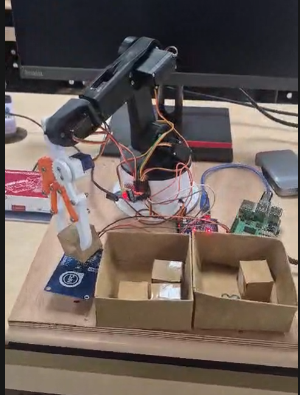
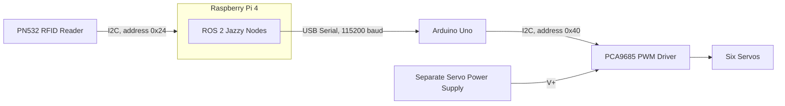
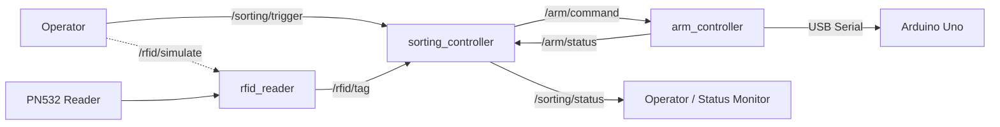

# Robotic RFID Sorting Cell

[](https://docs.ros.org/en/jazzy/)
[](https://www.python.org/)
[](https://ubuntu.com/)
[](https://www.arduino.cc/)
[](LICENSE)

A fixed robotic sorting cell that picks up manually placed objects using a 5-DOF robotic arm, identifies them through RFID tags, and sorts them into designated bins. A Raspberry Pi 4 runs the ROS 2 nodes, while an Arduino Uno controls the servos through a PCA9685 PWM driver.

**Scope:** This project implements a fixed sorting cell. A conveyor belt, automatic object detection, grip verification, and placement verification sensors are not part of the current implementation. The repository retains its original name, `autonomous-conveyor-sorting-cell`, from the earlier project scope.

## Hardware Prototype

<p align="center">
  
</p>

The prototype integrates a 5-DOF robotic arm, a PN532 RFID reader, RFID-tagged objects, and dedicated sorting bins.

## Contents

1. [Contributors](#contributors)
2. [What It Does](#what-it-does)
3. [Architecture](#architecture)
4. [Hardware](#hardware)
5. [Wiring and Power](#wiring-and-power)
6. [Setup](#setup)
7. [Running the System](#running-the-system)
8. [Configuration](#configuration)
9. [Serial Protocol](#serial-protocol)
10. [Tests](#tests)
11. [Verification Status](#verification-status)
12. [Troubleshooting](#troubleshooting)
13. [Safety Notes](#safety-notes)
14. [Future Work](#future-work)
15. [Repository Layout](#repository-layout)
16. [License](#license)

---

## Contributors

- Diya Jabin
- Grace Maria James
- Basil Joseph

---

## What It Does

The sorting system executes one sorting cycle whenever a trigger message is received. The sequence is orchestrated by `sorting_controller.py` through `SortingControllerCore.run_cycle`.

1. **Home:** Move the arm to `HOME_POSITION`.
2. **Open gripper:** Prepare the gripper to pick up the object.
3. **Pick:** Move to `PICK_DOWN_POSITION` at the pickup spot.
4. **Grip:** Close the gripper around the object.
5. **Lift:** Move to `LIFT_POSITION` to raise the object clear of the pickup spot.
6. **Move to RFID reader:** Carry the object to `RFID_SCAN_POSITION`, above the fixed PN532 reader, and allow 0.5 seconds for the object to settle.
7. **Read tag:** Wait up to 15 seconds for an RFID UID on `/rfid/tag`.
8. **Identify object:** Look up the UID in `config/object_map.yaml`.
9. **Select destination:** Determine the destination bin associated with the object.
10. **Move to floating pose:** Move to `FLOATING_POSITION` before approaching the selected bin.
11. **Sort:** Move to `BIN_A_POSITION` or `BIN_B_POSITION`.
12. **Release and return:** Release the object, report the sorting result, and return to `HOME_POSITION`.

Each position command sends the five joints sequentially in this order: base, shoulder, elbow, wrist roll, and wrist pitch.

The controller waits for `joint_gap_seconds` (0.6 seconds) between joints and `move_settle_seconds` (2 seconds) after the final joint command. It also waits `gripper_settle_seconds` (1 second) after each gripper command. These delays account for the fact that the Arduino acknowledges a command before the servo has necessarily finished moving.

### Failure Handling

| Failure | Status published | Response |
|---|---|---|
| Required arm position is missing | `ERROR:INVALID_CONFIGURATION:MISSING_POSITION:<names>` | Attempts to return home, then publishes `IDLE` |
| RFID tag is not received before timeout | `ERROR:RFID_TIMEOUT` | Attempts to return home while holding the object |
| UID is not in the object map | `ERROR:UNKNOWN_UID:<uid>` | Attempts to return home while holding the object |
| Arm command is rejected, times out, or serial communication fails | `ERROR:ARM_FAILURE:...` | Attempts to return home |
| Final move home fails after sorting | `ERROR:ARM_FAILURE:HOME:...` | Stops without retrying or publishing a final `IDLE` |

A recovery move is best-effort: the controller tries to return home once. If that attempt also fails, it logs the error and publishes `IDLE`. The gripper is not deliberately opened during failure handling, preventing an intentional release at an arbitrary position. Triggers received while a cycle is running are ignored rather than queued.

---

## Architecture

### Hardware Communication



### ROS 2 Node Architecture



### ROS 2 Nodes

All three nodes belong to the `sorting_cell` package in `ros2_ws/src/sorting_cell/sorting_cell/`.

| Node | Files | Responsibility |
|---|---|---|
| `arm_controller` | `arm_controller.py`, `serial_interface.py` | Validates arm commands, communicates with the Arduino over serial, and publishes command status |
| `rfid_reader` | `rfid_reader.py` | Polls the PN532 over I2C and publishes detected tag UIDs |
| `sorting_controller` | `sorting_controller.py`, `object_map.py`, `positions.py` | Coordinates pickup, RFID identification, bin selection, release, and reporting |

### ROS 2 Topics

All topics use `std_msgs/msg/String`.

| Topic | Publisher | Purpose |
|---|---|---|
| `/sorting/trigger` | Operator | Starts a sorting cycle |
| `/sorting/status` | `sorting_controller` | Publishes sorting progress and errors |
| `/arm/command` | `sorting_controller` or operator | Sends arm and gripper commands |
| `/arm/status` | `arm_controller` | Publishes arm command execution status |
| `/rfid/tag` | `rfid_reader` | Publishes detected UIDs as uppercase hexadecimal strings |
| `/rfid/simulate` | Operator | Injects a UID for testing |

Example UID: `1DF058BA141080`

### Sorting Status Sequence

A successful cycle publishes status messages in approximately this order:

| Status | Meaning |
|---|---|
| `IDLE` | System is idle |
| `CYCLE_START` | Trigger accepted |
| `EXECUTING:MOVE_TO_HOME_POSITION` | Moving to home |
| `EXECUTING:OPEN_GRIPPER` | Preparing the gripper |
| `EXECUTING:MOVE_TO_PICK_DOWN_POSITION` | Moving to the object |
| `EXECUTING:GRIP` | Gripping the object |
| `EXECUTING:LIFT_AFTER_GRIP` | Lifting the object |
| `EXECUTING:MOVE_TO_RFID_SCAN` | Moving over the RFID reader |
| `WAITING_FOR_RFID` | Waiting for a tag |
| `RFID_DETECTED:<uid>` | RFID tag received |
| `IDENTIFIED:<object_name>` | UID matched to an object |
| `BIN_SELECTED:<bin>` | Destination selected |
| `EXECUTING:MOVE_TO_FLOATING` | Moving to an intermediate pose |
| `EXECUTING:MOVE_TO_BIN:<bin>` | Moving to the destination bin |
| `EXECUTING:RELEASE` | Releasing the object |
| `REPORT:SORTED:<uid>:<object_name>:<bin>` | Sorting result reported |
| `IDLE` | Cycle finished |

### Important Parameters

**`arm_controller`**

| Parameter | Default | Description |
|---|---|---|
| `mock_mode` | `false` | Simulates Arduino responses without opening the serial port |
| `serial_port` | `/dev/ttyACM0` | Serial device; this cell has used `/dev/ttyUSB0` |
| `baud_rate` | `115200` | Serial communication speed |
| `serial_timeout` | `1.0` s | Timeout for an Arduino response |

**`rfid_reader`**

| Parameter | Default | Description |
|---|---|---|
| `mock_mode` | `true` at node level | Launch configuration normally enables real hardware mode |
| `poll_interval` | `0.2` s | RFID polling interval |
| `i2c_address` | `0x24` | PN532 I2C address |

**`sorting_controller`**

| Parameter | Default | Description |
|---|---|---|
| `arm_command_timeout` | `5.0` s | Timeout for arm command completion |
| `rfid_timeout` | `15.0` s | Maximum wait for a tag |
| `move_settle_seconds` | `2.0` s | Delay after a position move |
| `gripper_settle_seconds` | `1.0` s | Delay after a gripper command |
| `rfid_settle_seconds` | `0.5` s | Delay before waiting for the RFID tag |
| `joint_gap_seconds` | `0.6` s | Delay between joint commands |

---

## Hardware

| Component | Details |
|---|---|
| Main computer | Raspberry Pi 4 Model B, 4 GB RAM |
| Microcontroller | Arduino Uno |
| PWM driver | PCA9685, 16-channel, 12-bit, I2C address `0x40` |
| Robotic arm | Bench Robotics 5-DOF 3D-printed arm |
| Base, shoulder, elbow | 3 × MG996R servos |
| Wrist roll, wrist pitch, gripper | 3 × MG90S servos |
| RFID reader | PN532 NFC/RFID module |
| RFID tags | NTAG213 |
| Servo power | Separate supply connected to the PCA9685 V+ terminal |
| Sorting bins | Fixed destination bins |

---

## Wiring and Power

Refer to [`hardware/WIRING.md`](hardware/WIRING.md) for the detailed wiring tables.

### Raspberry Pi to PN532

The reader is intended to communicate with the Raspberry Pi over I2C.

| PN532 connection | Raspberry Pi connection |
|---|---|
| GND | Physical pin 6 (GND) |
| SDA | Physical pin 3 (GPIO 2 / SDA) |
| SCL | Physical pin 5 (GPIO 3 / SCL) |
| IRQ, RST, SPI pins | Not connected in the current I2C configuration |

The PN532 module's interface-selection switches must be configured for I2C. The expected I2C address is `0x24`.

**Electrical warning:** Confirm the exact module's supply and logic-level requirements before powering it. Raspberry Pi GPIO uses 3.3 V logic. Do not connect a 5 V signal to a Raspberry Pi GPIO pin.

### Arduino to PCA9685

- Arduino Uno I2C uses A4 (SDA) and A5 (SCL).
- Connect the Arduino and PCA9685 grounds together.
- The Raspberry Pi communicates with the Arduino through USB serial at 115200 baud.
- On this setup, the Arduino has used `/dev/ttyUSB0`; check the actual device before running the nodes.

### Servo Channels and Calibration

The following PCA9685 PWM counts are configured in the Arduino firmware.

| Channel | Joint | Servo | Minimum | Midpoint | Maximum |
|---|---|---|---:|---:|---:|
| CH0 | Base | MG996R | 100 | 310 | 520 |
| CH1 | Shoulder | MG996R | 100 | 310 | 520 |
| CH2 | Elbow | MG996R | 100 | 310 | 520 |
| CH3 | Wrist roll | MG90S | 87 | 313 | 538 |
| CH4 | Wrist pitch | MG90S | 87 | 313 | 538 |
| CH5 | Gripper | MG90S | 87 | 311 | 535 |

These are PWM calibration counts, not physical angles.

### Power Safety

- Power the servos from a separate, suitably rated supply connected to the PCA9685 V+ terminal.
- Never power the complete servo assembly from the Arduino's 5 V pin or USB supply.
- Ensure the servo supply ground and Arduino ground are connected.
- Provide sufficient current capacity for servo startup and stall currents.
- A USB power bank caused shaking and stalling during earlier testing; it should not be treated as a verified supply for simultaneous servo operation.

---

## Setup

The following steps are intended to run on the Raspberry Pi unless stated otherwise.

### 1. Install Ubuntu Server

Install Ubuntu Server 24.04 for the Raspberry Pi using Raspberry Pi Imager. Enable SSH in the imager settings, boot the Pi, and connect over SSH.

### 2. Install ROS 2 Jazzy

Follow the official ROS 2 installation instructions:

https://docs.ros.org/en/jazzy/Installation/Ubuntu-Install-Debs.html

The `ros-jazzy-ros-base` installation is sufficient for this project.

Source ROS 2 in new terminals:

```bash
echo "source /opt/ros/jazzy/setup.bash" >> ~/.bashrc
source ~/.bashrc
```

### 3. Enable I2C

Check `/boot/firmware/config.txt` and enable I2C if needed:

```text
dtparam=i2c_arm=on
```

Reboot the Raspberry Pi after changing the configuration.

### 4. Install System Dependencies

```bash
sudo apt update
sudo apt install i2c-tools python3-pip python3-colcon-common-extensions \
    python3-serial python3-yaml
```

### 5. Clone the Repository

```bash
git clone https://github.com/DiyaJabin/autonomous-conveyor-sorting-cell.git
cd autonomous-conveyor-sorting-cell
```

### 6. Install Python Dependencies

```bash
pip3 install -r ros2_ws/src/sorting_cell/requirements.txt --break-system-packages
```

This installs the Python dependencies required by the RFID reader and related hardware interfaces.

### 7. Build the ROS 2 Package

```bash
cd ros2_ws
colcon build --packages-select sorting_cell
source install/setup.bash
```

Source the workspace in every new terminal:

```bash
source /opt/ros/jazzy/setup.bash
source ~/autonomous-conveyor-sorting-cell/ros2_ws/install/setup.bash
```

Adjust the workspace path if the repository is stored elsewhere.

### 8. Flash the Arduino

Stop any ROS launch or serial monitor using the Arduino port before uploading firmware.

Install the Arduino CLI and required components if they are not already installed. From the repository root:

```bash
arduino-cli core update-index
arduino-cli core install arduino:avr
arduino-cli lib install "Adafruit PWM Servo Driver Library"
arduino-cli compile --fqbn arduino:avr:uno arduino/arm_controller
```

Check the detected port:

```bash
arduino-cli board list
```

Then upload, replacing `/dev/ttyUSB0` if necessary:

```bash
arduino-cli upload -p /dev/ttyUSB0 \
    --fqbn arduino:avr:uno arduino/arm_controller
```

### 9. Check the Hardware

Check the serial device:

```bash
ls /dev/ttyUSB* /dev/ttyACM*
```

Check the PN532 I2C address:

```bash
i2cdetect -y 1
```

The PN532 should appear at address `24` in the scan.

If serial access is denied, add the user to the `dialout` group and log in again:

```bash
sudo usermod -aG dialout "$USER"
```

If I2C access is denied, try running the I2C scan with `sudo`.

---

## Running the System

Only one application can use the Arduino's serial port at a time. Close the Arduino Serial Monitor and stop any other ROS process holding the port before launching the system.

### Terminal 1: Launch the Sorting Cell

```bash
source /opt/ros/jazzy/setup.bash
source ~/autonomous-conveyor-sorting-cell/ros2_ws/install/setup.bash

ros2 launch sorting_cell sorting_cell.launch.xml \
    mock_mode:=false serial_port:=/dev/ttyUSB0
```

### Terminal 2: Monitor Sorting Status

```bash
source /opt/ros/jazzy/setup.bash
source ~/autonomous-conveyor-sorting-cell/ros2_ws/install/setup.bash

ros2 topic echo /sorting/status
```

### Terminal 3: Monitor RFID Reads

```bash
source /opt/ros/jazzy/setup.bash
source ~/autonomous-conveyor-sorting-cell/ros2_ws/install/setup.bash

ros2 topic echo /rfid/tag
```

### Trigger a Sorting Cycle

Place an RFID-tagged object at the pickup position, then run:

```bash
ros2 topic pub --once /sorting/trigger \
    std_msgs/msg/String "data: ''"
```

A successful cycle should publish statuses similar to:

```text
CYCLE_START
EXECUTING:MOVE_TO_HOME_POSITION
EXECUTING:OPEN_GRIPPER
EXECUTING:MOVE_TO_PICK_DOWN_POSITION
EXECUTING:GRIP
EXECUTING:LIFT_AFTER_GRIP
EXECUTING:MOVE_TO_RFID_SCAN
WAITING_FOR_RFID
RFID_DETECTED:1DF058BA141080
IDENTIFIED:OBJECT_A2
BIN_SELECTED:BIN_A
EXECUTING:MOVE_TO_FLOATING
EXECUTING:MOVE_TO_BIN:BIN_A
EXECUTING:RELEASE
REPORT:SORTED:1DF058BA141080:OBJECT_A2:BIN_A
IDLE
```

A full cycle takes approximately 40 seconds, depending on motion and RFID timing.

### Mock Mode: Test Without Hardware

Mock mode simulates the arm's serial responses and does not access the physical serial port or I2C bus.

Start the system:

```bash
ros2 launch sorting_cell sorting_cell.launch.xml mock_mode:=true
```

In another terminal, trigger a cycle:

```bash
ros2 topic pub --once /sorting/trigger \
    std_msgs/msg/String "data: ''"
```

Wait until `/sorting/status` publishes `WAITING_FOR_RFID`, then inject a known UID:

```bash
ros2 topic pub --once /rfid/simulate \
    std_msgs/msg/String "data: '1DF058BA141080'"
```

The tag must be injected after the controller starts waiting for it. A tag received earlier may be discarded by the current implementation. To simulate the same UID again, publish an empty UID first so the reader can detect it as a new tag later.

---

## Configuration

The configuration files are located in:

```text
ros2_ws/src/sorting_cell/config/
├── arm_positions.yaml
└── object_map.yaml
```

Configuration files are installed during the build. Rebuild after editing them, or pass explicit file paths through the launch arguments.

### RFID Object Mapping

File: `config/object_map.yaml`

The current mapping is:

| UID | Object | Destination |
|---|---|---|
| `1DF058BA141080` | `OBJECT_A2` | `BIN_A` |
| `1DEF58BA141080` | `OBJECT_A3` | `BIN_A` |
| `1DEC58BA141080` | `OBJECT_B2` | `BIN_B` |
| `1DEE58BA141080` | `OBJECT_B3` | `BIN_B` |
| `1DED58BA141080` | `OBJECT_B4` | `BIN_B` |

To add another tag:

1. Run the RFID reader and watch `/rfid/tag`.
2. Hold the tag over the reader and record its UID.
3. Add the UID under the `objects:` section of `object_map.yaml`.
4. Assign an object name and destination bin.
5. Rebuild the ROS 2 package.

Example entry:

```yaml
objects:
  1DXXXXXXXXXXXX:
    object_name: OBJECT_A4
    bin: BIN_A
```

The destination must correspond to a pose named `<bin>_POSITION` in `arm_positions.yaml`. Multiple tags may map to the same bin.

An unrecognized UID causes `ERROR:UNKNOWN_UID:<uid>`.

### Arm Positions

File: `config/arm_positions.yaml`

Angles are specified in degrees. `wrist` refers to wrist roll (CH3), and `wrist_pitch` refers to CH4.

| Pose | Base | Shoulder | Elbow | Wrist | Wrist pitch |
|---|---:|---:|---:|---:|---:|
| `HOME_POSITION` | 0 | 105 | 95 | 100 | 90 |
| `PICK_DOWN_POSITION` | 0 | 85 | 175 | 35 | 95 |
| `LIFT_POSITION` | 0 | 85 | 125 | 35 | 95 |
| `RFID_SCAN_POSITION` | 55 | 90 | 175 | 0 | 100 |
| `FLOATING_POSITION` | 55 | 110 | 155 | 15 | 100 |
| `BIN_A_POSITION` | 85 | 110 | 155 | 15 | 100 |
| `BIN_B_POSITION` | 110 | 110 | 155 | 15 | 100 |

**Pose notes:**

- `HOME_POSITION`, `PICK_DOWN_POSITION`, `LIFT_POSITION`, `RFID_SCAN_POSITION`, and `FLOATING_POSITION` are required.
- `LIFT_POSITION` is derived from the pickup pose rather than independently measured.
- `FLOATING_POSITION` uses the same base angle as the RFID scan pose, with the other joints aligned to the bin poses.
- `BIN_A_POSITION` was measured on 2026-10-15.
- `PICK_DOWN_POSITION` and `RFID_SCAN_POSITION` were re-measured on 2026-10-20.
- `BIN_B_POSITION` uses a measured base angle and joint values aligned with the checked `BIN_A_POSITION` pose.

Re-measure poses before relying on them after changing the arm, servo horns, or mechanical assembly.

### Joint Limits

The ROS 2 arm controller validates commanded joint angles against configured limits.

| Joint | Minimum | Maximum |
|---|---:|---:|
| Base | 0° | 180° |
| Shoulder | 15° | 165° |
| Elbow | 15° | 175° |
| Wrist roll | 0° | 180° |
| Wrist pitch | 0° | 180° |

The elbow value of 175° in the pickup and scan poses is at the configured upper limit. The wrist value of 0° in the scan pose is at its lower limit. These poses require careful hardware validation.

The ROS-side joint limits are configured in `arm_controller.py`, both in the node parameters and the corresponding parser defaults. The Arduino firmware itself accepts angles from 0° to 180°.

### Re-Measuring a Pose

1. Stop any ROS launch using the Arduino serial port.
2. Open a serial monitor at 115200 baud with newline line endings.
3. Jog one joint at a time, using small increments.
4. Record the five joint angles for the desired pose.
5. Update `arm_positions.yaml`.
6. Rebuild and test the updated pose carefully.

Example low-level commands:

```text
BASE:55
SHOULDER:90
ELBOW:170
WRIST:0
WRIST_PITCH:100
GRIPPER:OPEN
GRIPPER:CLOSE
```

**Safety:** Do not send the Arduino firmware's `HOME` command to the assembled arm unless its all-zero position has been verified safe. The firmware sends all joints to 0°, independently of the ROS-side limits.

---

## Serial Protocol

The Arduino firmware uses ASCII commands at 115200 baud, 8N1. Each command ends with a newline (`\n`); carriage returns are ignored.

The Arduino replies as soon as a target is accepted, not when the physical movement has finished.

| Command | Expected reply | Effect |
|---|---|---|
| `BASE:<angle>` | `OK:BASE` | Commands CH0 |
| `SHOULDER:<angle>` | `OK:SHOULDER` | Commands CH1 |
| `ELBOW:<angle>` | `OK:ELBOW` | Commands CH2 |
| `WRIST:<angle>` | `OK:WRIST` | Commands CH3 |
| `WRIST_PITCH:<angle>` | `OK:WRIST_PITCH` | Commands CH4 |
| `GRIPPER:OPEN` | `OK:GRIPPER` | Sends the configured open setpoint |
| `GRIPPER:CLOSE` | `OK:GRIPPER` | Sends the configured close setpoint |
| `HOME` | `OK:HOME` | Commands all joints to their firmware home setpoints |

The `<angle>` argument must be a number from 0 to 180. Decimal values are accepted by the firmware.

On the ROS side, `/arm/command` uses spaces instead of colons, for example:

```text
BASE 90
GRIPPER OPEN
GRIPPER CLOSE
```

### Error Responses

The Arduino returns `ERROR:INVALID_COMMAND` for malformed commands, unknown targets, invalid gripper values, non-numeric angles, angles outside the allowed range, or overlong command lines.

The ROS 2 controller may also report:

| Status | Meaning |
|---|---|
| `ERROR:INVALID_COMMAND` | Command validation failed |
| `ERROR:SERIAL_TIMEOUT` | Arduino did not respond before the serial timeout |
| `ERROR:ARDUINO_DISCONNECTED` | Serial communication failed |
| `ERROR:SERIAL_CONNECTION` | The serial port could not be opened |
| `ERROR:MALFORMED_RESPONSE:<text>` | The response did not match the expected format |
| `ERROR:ARM_TIMEOUT` | The sorting controller did not receive a terminal arm status in time |

**Gripper calibration note:** The software command names should match the intended physical action. Verify the current firmware's angle setpoints and the gripper's observed opening/closing direction before running a complete sorting cycle. A servo horn installed in the opposite orientation can reverse the physical motion.

---

## Tests

Run the Python unit tests from the package directory:

```bash
cd ros2_ws/src/sorting_cell
python3 -m pytest
```

The project documentation records 234 unit tests, covering:

| Test file | Tests |
|---|---:|
| `test/test_arm_controller.py` | 105 |
| `test/test_sorting_controller.py` | 58 |
| `test/test_object_map.py` | 28 |
| `test/test_positions.py` | 26 |
| `test/test_rfid_reader.py` | 17 |
| **Total** | **234** |

These tests cover Python logic, including command parsing, joint limits, serial handling with a fake port, sorting-cycle logic with mocked dependencies, and configuration validation.

They do not, by themselves, verify physical hardware operation, Arduino firmware behavior, or ROS node integration.

Run the tests again after changing the code and update the documented test count if the suite changes.

---

## Verification Status

The following table reflects the verification status recorded in the project documentation. Re-run the relevant checks whenever the firmware, wiring, configuration, or ROS nodes change.

| Verified on hardware | Unit-tested in software | Not implemented |
|---|---|---|
| Raspberry Pi-to-Arduino serial communication | Recovery and failure-handling paths | Conveyor |
| Joint and gripper motion through ROS | Joint-limit checks | Automatic object detection |
| PN532 reads through `rfid_reader` | Configuration loading and validation | Grip verification |
| Full pick, scan, and sorting cycles into both bins | Settle and joint-gap waits | Placement verification |
| | | Per-joint speed smoothing in firmware |

### Known Limitations

- The elbow angle is at the configured upper limit in the pickup and RFID scan poses.
- The wrist roll angle is at its lower limit in the RFID scan pose.
- Following an RFID timeout or unknown UID, the controller attempts to return home while still holding the object.
- A complete sorting cycle takes approximately 40 seconds.
- Joints move sequentially at their configured servo speed; firmware-level speed ramps are not implemented.
- A tag detected during movement or settling may be discarded before the controller begins waiting for RFID input. The reader does not continuously republish an unchanged UID.
- If PN532 initialization fails at startup, the reader may need to be restarted after correcting the hardware or bus issue.
- Mock mode and certain launch configurations require separate end-to-end validation.

---

## Troubleshooting

| Symptom | Possible cause | Suggested action |
|---|---|---|
| `ros2: command not found` | ROS 2 environment not sourced | Source `/opt/ros/jazzy/setup.bash` and the workspace setup file |
| `ERROR:SERIAL_TIMEOUT` | Wrong firmware, port, or serial communication issue | Verify the firmware, baud rate, and serial device |
| `ERROR:SERIAL_CONNECTION` | Incorrect port or another process holds it | Check `/dev/ttyUSB*` and `/dev/ttyACM*`; close other serial applications |
| `ANGLE_OUT_OF_LIMITS` | Command exceeds ROS-side limits | Inspect the joint limits and requested pose |
| PN532 initialization failure | Wiring, I2C configuration, address, or bus issue | Check the wiring, enable I2C, and confirm the expected address |
| `ERROR:RFID_TIMEOUT` | Tag is too far away, incorrectly oriented, or the read was missed | Check tag placement, scan pose, and RFID topic output |
| Arm shakes or stalls | Insufficient servo power or mechanical binding | Check the separate servo supply and mechanical clearances |
| Gripper moves in the wrong direction | Firmware setpoints or servo orientation do not match the intended action | Verify the gripper command mapping and test carefully |
| Launch stops after SSH disconnects | Process is tied to the SSH session | Run it inside `tmux` or `screen` |

---

## Safety Notes

- Keep the arm's movement area clear during testing.
- Keep the servo power switch accessible.
- Watch for mechanical binding, buzzing, overheating, or stalled servos.
- Do not repeatedly command a stalled servo.
- Use a properly rated external servo supply and common ground.
- Verify every pose on the physical arm before running a complete sorting cycle.
- Never assume the Arduino firmware's all-zero `HOME` pose is mechanically safe.
- Do not leave the gripper clamped on an object longer than necessary; the servo may continue applying force and heat up.
- The prototype is an educational robotic system and is not represented as an industrial safety-certified system.

---

## Future Work

Potential extensions include:

- Conveyor integration and automatic object detection.
- Grip verification and placement verification sensors.
- Smoother joint motion and per-joint speed ramps.
- Reliable buffering of RFID reads during movement.
- Dedicated recovery and failure states.
- Improved diagnostics and long-duration RFID reliability testing.

These are future extensions and are not part of the current fixed-cell implementation.

---

## Repository Layout

```text
autonomous-conveyor-sorting-cell/
├── README.md
├── LICENSE
├── docs/
│   ├── arm.png
│   ├── ros2_arm_controller.md
│   └── arduino_pca9685_subsystem.md
├── hardware/
│   └── WIRING.md
├── arduino/
│   └── arm_controller/
│       └── arm_controller.ino
└── ros2_ws/
    └── src/
        └── sorting_cell/
            ├── config/
            │   ├── arm_positions.yaml
            │   └── object_map.yaml
            ├── launch/
            │   ├── sorting_cell.launch.xml
            │   └── arm.launch.xml
            ├── sorting_cell/
            ├── test/
            └── requirements.txt
```

---

## License

Licensed under the Apache License, Version 2.0. See the [LICENSE](LICENSE) file.

Copyright 2026 Diya Jabin, Grace Maria James, and Basil Joseph.
